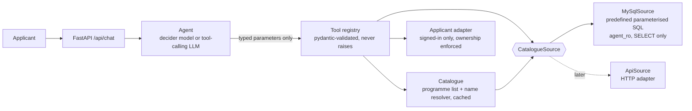

# Agent architecture: tools over a read-only data source



## Rules the design enforces

1. **The model never writes SQL or URLs.** It picks a tool and fills typed parameters (enums, ints, short strings). Anything that fails validation is rejected before a query exists.
2. **One interface, two back ends.** Every programme fact comes from it; there is no scraped website data anywhere in the app. Tools call `CatalogueSource` (`app/sources/base.py`). Today that is `MySqlSource`. When an API replaces the DB, write `ApiSource` (stub in `api_source.py`) and set `CATALOGUE_SOURCE=api`. No tool, prompt or test of tool logic changes.
3. **Least privilege.** The agent connects as `agent_ro`, which has `SELECT` on 11 public-content tables and nothing else (no personal tables, no writes, no `GRANT`). The session is also forced `READ ONLY`, with a 5 s query limit, a 200-row cap and no multi-statements. `tests/test_sources.py` proves the DELETE, the personal-table read and the stacked statement are all refused.
4. **No source, no guessing.** If the source is down or not configured, tools return `catalogue_unavailable`, the pages return HTTP 503, and the agent says the database cannot be reached instead of answering from memory.
5. **Honest data.** Text is returned exactly as published (HTML converted to text). Missing data is `found=false`. The DB is a snapshot: for example course 334 still carries 2017-18 application dates, so each result carries a note and the prompt sends date questions to the live-site tools.
6. **Applicant data stays separate.** Applicant tools exist only for signed-in users and the adapter enforces ownership. The agent DB account cannot see applicant tables at all.

## Tool catalogue

| Tool | Answers | Backed by |
|---|---|---|
| `search_programmes(query, level?, campus?)` | find a programme, get `course_id` | `courses`, `course_category`, `campus_master`, `departments` |
| `get_programme_details(programme_id)` | level, campus, department, duration, term type, intake, overview, selection | `courses` (+ joins) |
| `get_programme_section(programme_id, section)` | eligibility, fees, selection, outcomes, structure, entrance test, placements, scholarship (exact text); also `get_eligibility_criteria`, `get_fee_structure`, `assess_preliminary_eligibility` | `course_related_links` (newest active row per name) |
| `get_programme_highlights(programme_id)` | why choose, what you learn, careers, modules | `course_info` |
| `get_curriculum(programme_id, year?)` | term-by-term subjects and credits, phase roadmap | `academic_curriculum_master/details`, `programme_roadmap` |
| `get_admission_process(group?)` | how to apply, selection, dates per programme group (ug mgmt, pg science, phd arts...) | `adm_links` |
| `list_campuses()` | active campuses | `campus_master` |
| `get_admission_dates(programme_id?)` | application open/close dates recorded on the programme(s), flagged as possibly out of date | `courses` |
| applicant tools (`get_my_applications`, `get_application_status`) | the signed-in applicant's own records | applicant adapter |

## Table inventory (database `applicant`, 788 courses of which 623 active)

**Used by the agent (granted to `agent_ro`)**

| Table | What it holds | Notes |
|---|---|---|
| `courses` | programme master record | `course_status='Y'` is active; HTML in description fields |
| `course_related_links` | eligibility, fees, selection, outcomes, structure as HTML | many old versions: `rel_link_status='Y'` and highest `rel_link_id` per name is current |
| `course_info` | why choose / what you learn / careers / modules (type 1-4) | `status=1` |
| `course_category` | level (undergraduate, postgraduate, doctoral, international...) | |
| `campus_master`, `departments`, `department_courses` | campuses, departments, programme-to-department links | |
| `academic_curriculum_master`, `academic_curriculum_details` | term-wise subjects and credits | `chrStatus='1'` |
| `programme_roadmap` | phase roadmap per programme | `chrStatus='Y'` |
| `adm_links` | admission process text per programme group | the `f_email` column is never selected |

**Relevant but not used yet**: `vw_search_index` (view over content/courses/centres/departments, a candidate for site-wide search once its underlying grants are decided), `page_master`, `online_service_*` (online programme services), `programm_master`.

**Personal or operational. Deliberately NOT granted, never read by the agent**: `enquiry`, `pdp_registrations`, `log`, `admin_rights`, `council_members`, `student_profile`, and similar registration, admin and log tables.

**Legacy or noise**: old inactive versions in `course_related_links` (`status='N'`, about 2,400 rows), inactive categories and campuses, three MyISAM leftovers.

## Setup

```
# .env (gitignored)
CATALOGUE_SOURCE=mysql        # mysql | api | none  (default: mysql when AGENT_DB_USER is set)
AGENT_DB_USER=agent_ro
AGENT_DB_PASSWORD=...
APPLICANT_DB_HOST/PORT/NAME   # shared connection target
```

Create the account on any server holding the dump: `CREATE USER 'agent_ro'@'localhost' ...; GRANT SELECT ON applicant.<table> ...` for the tables in the first inventory only.

## Next steps

* Swap `MySqlSource` for an API-backed `ApiSource` when the real API exists (same dict shapes, including `list_catalogue`).
* Not in the granted tables, so not answerable today: hostel, campus facilities, general scholarships, contact details, FAQs, university profile. Tables such as `faq`, `campus_fecilities` and `content` exist in the dump; granting `agent_ro` SELECT on reviewed tables would let the agent answer these.
* Application dates in `courses` are stale (newest close date 2020-06-23); the app labels them as recorded, not current.
* Hosting: Vercel cannot reach a localhost database. Host the app beside the DB, or expose the catalogue through the API adapter.
