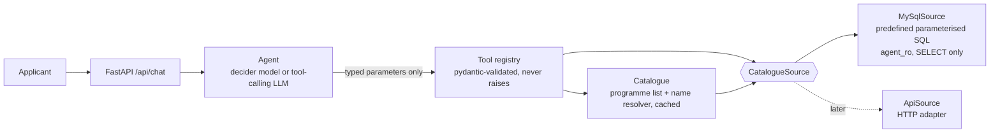
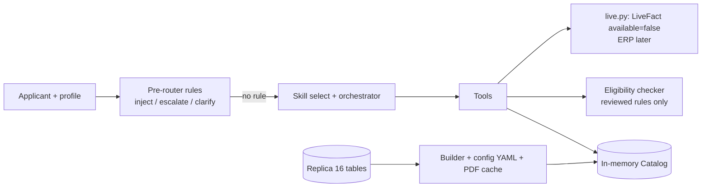

# Agent architecture: tools over a read-only data source



## Rules the design enforces

1. **The model never writes SQL or URLs.** It picks a tool and fills typed parameters (enums, ints, short strings). Anything that fails validation is rejected before a query exists.
2. **One interface, two back ends.** Every programme fact comes from it; there is no scraped website data anywhere in the app. Tools call `CatalogueSource` (`app/sources/base.py`). Today that is `MySqlSource`. When an API replaces the DB, write `ApiSource` (stub in `api_source.py`) and set `CATALOGUE_SOURCE=api`. No tool, prompt or test of tool logic changes.
3. **Least privilege.** The agent connects as `agent_ro`, which has `SELECT` on 11 public-content tables and nothing else (no personal tables, no writes, no `GRANT`). The session is also forced `READ ONLY`, with a 5 s query limit, a 200-row cap and no multi-statements. `tests/test_sources.py` proves the DELETE, the personal-table read and the stacked statement are all refused.
4. **No source, no guessing.** If the source is down or not configured, tools return `catalogue_unavailable`, the pages return HTTP 503, and the agent says the database cannot be reached instead of answering from memory.
5. **Honest data.** Text is returned exactly as published (HTML converted to text). Missing data is `found=false`. The DB is a snapshot: for example course 334 still carries 2017-18 application dates, so each result carries a note and the prompt sends date questions to the live-site tools.
6. **No applicant data.** The database is the website CMS: it has no applicant accounts, applications or logins, and the app has none either (no sign-in, no mock). Questions about someone's own application get a plain "I can't see applications" with the real status-page link and office contact from the data. The tables with personal data (`enquiry`, `pdp_registrations`, `member_payments`) are never granted.

## Tool catalogue

| Tool | Answers | Backed by |
|---|---|---|
| `search_programmes(query, level?, campus?)` | find a programme, get `course_id` | `courses`, `course_category`, `campus_master`, `departments` |
| `get_programme_details(programme_id)` | level, campus, department, duration, term type, intake, overview, selection | `courses` (+ joins) |
| `get_programme_section(programme_id, section)` | eligibility, fees, selection, outcomes, structure, entrance test, placements, scholarship (exact text); also `get_eligibility_criteria`, `get_fee_structure`, `assess_preliminary_eligibility` | `course_related_links` (newest active row per name) |
| `get_programme_highlights(programme_id)` | why choose, what you learn, careers, modules | `course_info` |
| `get_curriculum(programme_id, year?)` | term-by-term subjects and credits, phase roadmap | `academic_curriculum_master/details`, `programme_roadmap` |
| `get_admission_process(group?)` | how to apply, selection, dates per programme group (ug mgmt, pg science, phd arts...) | `adm_links` |
| `get_campus_details(campus?)` | address, phones, official email, website, description of each active campus | `campus_master` |
| `get_campus_facilities(campus?, facility?)` | hostel/accommodation, library, transport, medical... (active entries only; needs the grant in `docs/agent_ro_grants.sql`, otherwise reported as unavailable) | `campus_fecilities` |
| `recommend_programmes(interests, level?, campus?)` | suggestions for the recommendation agent only (name and department matching, career paths) | `courses`, `departments`, `course_info` |
| `get_admission_dates(programme_id?)` | application open/close dates recorded on the programme(s), flagged as possibly out of date | `courses` |

## Table inventory (database `applicant`, 788 courses of which 623 active)

**Used by the agent (granted to `agent_ro`)**

| Table | What it holds | Notes |
|---|---|---|
| `courses` | programme master record | `course_status='Y'` is active; HTML in description fields |
| `course_related_links` | eligibility, fees, selection, outcomes, structure as HTML | many old versions: `rel_link_status='Y'` and highest `rel_link_id` per name is current |
| `course_info` | why choose / what you learn / careers / modules (type 1-4) | `status=1` |
| `course_category` | level (undergraduate, postgraduate, doctoral, international...) | |
| `campus_master`, `departments`, `department_courses` | campuses, departments, programme-to-department links | |
| `academic_curriculum_master`, `academic_curriculum_details` | term-wise subjects and credits | `chrStatus='1'` |
| `programme_roadmap` | phase roadmap per programme | `chrStatus='Y'` |
| `adm_links` | admission process text per programme group | the `f_email` column is never selected |

**Granted on request** (`docs/agent_ro_grants.sql`): `campus_fecilities` (campus facilities).

**Relevant but not used yet**: `content` (33k rows of CMS pages, mostly menu links and duplicate versions, needs curation before it can be trusted), `settings` (university and campus contact rows, duplicates `campus_master`), `vw_search_index` (view over content/courses/centres/departments, a candidate for site-wide search once its underlying grants are decided), `page_master`, `online_service_*` (online programme services), `programm_master`.

**Personal or operational. Deliberately NOT granted, never read by the agent**: `enquiry`, `pdp_registrations`, `log`, `admin_rights`, `council_members`, `student_profile`, and similar registration, admin and log tables.

**Legacy or noise**: old inactive versions in `course_related_links` (`status='N'`, about 2,400 rows), inactive categories and campuses, three MyISAM leftovers.

## Setup

```
# .env (gitignored)
CATALOGUE_SOURCE=mysql        # mysql | api | none  (default: mysql when AGENT_DB_USER is set)
AGENT_DB_USER=agent_ro
AGENT_DB_PASSWORD=...
APPLICANT_DB_HOST/PORT/NAME   # shared connection target
```

Create the account on any server holding the dump: `CREATE USER 'agent_ro'@'localhost' ...; GRANT SELECT ON applicant.<table> ...` for the tables in the first inventory only.

## Next steps

* Swap `MySqlSource` for an API-backed `ApiSource` when the real API exists (same dict shapes, including `list_catalogue`).
* Not in the granted tables, so not answerable today: hostel, campus facilities, general scholarships, contact details, FAQs, university profile. Tables such as `faq`, `campus_fecilities` and `content` exist in the dump; granting `agent_ro` SELECT on reviewed tables would let the agent answer these.
* Application dates in `courses` are stale (newest close date 2020-06-23); the app labels them as recorded, not current.
* Hosting: Vercel cannot reach a localhost database. Host the app beside the DB, or expose the catalogue through the API adapter.

---

# Blueprint implementation (current)

Implements `Applicant Co-pilot Build Blueprint.pdf` **except the ERP client and the aggregation layer** (deferred, see `app/live.py`).



| Blueprint item | Where |
|---|---|
| Catalog schema (frozen dataclasses, provenance, no fee/date kind) | `app/catalog/models.py` |
| Fixed SQL for 16 tables, allow-list, personal tables unreachable | `app/catalog/queries.py`, `reader.py` |
| Cleaning (HTML to text, tables, mojibake, double escaping, base64 images) | `app/catalog/clean.py` |
| Section typing, year/audience detection, older cycles dropped | `app/catalog/classify.py`, `config/section_kinds.yaml` |
| Build, sanity checks, per-table degrade on missing grants | `app/catalog/builder.py` |
| Indexes: alias, filter, topic, ERP id, BM25 | `app/catalog/indexes.py` |
| Refresh: checksum skip, background build, 20%/30% guards, atomic swap, diff report, snapshot | `app/catalog/refresh.py`, `snapshot.py`, `app/routers/admin.py` |
| Eligibility rules, normalisation, deterministic checker, draft extractor | `app/eligibility/`, `config/eligibility_rules.yaml` |
| Ranking (filter by eligibility first, then BM25) and comparison | `app/eligibility/recommend.py` |
| Pre-router, skills, orchestrator | `app/agent/prerouter.py`, `skills.py`, `orchestrator.py` |
| 25 tools incl. `resolve_program`, `search_programs`, `get_specializations`, `get_documents`, `search_content`, `get_topic_info`, `get_campus_contacts`, `check_eligibility`, `rank_programs`, `compare_programs`, `create_handoff` | `app/tools/blueprint.py`, `registry.py` |
| PDF pipeline (fetch by hash, pypdf/pdfplumber, optional OCR, fee/date pages dropped) | `app/documents/` |
| Golden / red-team evaluation | `eval/` |

**Not implemented (by decision):** the ERP client, aggregation layer (TTL cache, circuit breaker, ID-mapping validation against the ERP, conflict log)
and the authenticated applicant-status flow. `get_fees`, `get_application_dates`, `get_seats`, `get_hostel_vacancy` and `get_application_status`
return the final `LiveFact` envelope with `available=false`; connect the ERP by filling those five functions.
`create_handoff` prepares the summary and contact but sends nothing (no ticket endpoint yet).

**Behaviour changes versus the previous per-request design:** fee text and recorded application dates are no longer served anywhere (API page,
tools, decision engine); `adm_links` (2016-2020 text) is no longer used; the default source is the in-memory catalog (`CATALOGUE_SOURCE=mysql` keeps the legacy path).

## Conversation layer (dialog manager)

`app/agent/dialog.py` runs before any model: message → small-talk / fact-intent / search detection → conversation state → `app/catalog/search.py` (strict, deduplicated, ranked) → answer built from catalog records.

* **Structured fields:** every programme has `degree_type` (B.Tech, BSc, BCA, MSc, PhD...), `academic_level`, `field`, `specialization`, `entry` (regular/lateral) and a `dedupe_key`, derived from the stored name by `app/catalog/normalize.py`. `app/catalog/record.py` returns the full clean record.
* **Strict filtering:** a requested degree matches `degree_type`; a specialization (AI/ML, Data Science, Cyber Security...) must be in the programme's own name/field/specialization; B.E is never treated as B.Tech (it offers the B.Tech list as a question instead). Related programmes are offered only when no strict filter was given.
* **State per chat:** `{degree, level, concepts, words, campus, programme_id}` comes back with every reply and is sent again by the browser; the server stores nothing, so chats cannot mix. Client-sent state is validated.
* **No repeats:** small talk picks a line not already said in this conversation; the welcome message is only shown at the start; `client_msg_id` makes a double submit run once (cached answer, shared in-flight request); the UI sends one request at a time.
* Anything the layer does not recognise falls through to the model; a failure inside it is logged and falls through too.

## Conversation state, numbered choices and fees (current behaviour)

* **State** (`app/catalog/search.py::State`): `degree`, `level`, `concepts` (specialization/field), `words`, `campus`, `programme_id`, `last_ids` (the result list last shown),
  `pending` (a numbered question: `{"action": "select_programme", "requested": "fees"|null, "options": [{"number", "programme_id"}]}`) and `last_intent`. It comes back with every
  reply, is kept by the browser across refreshes, and is validated against the catalog on every request (unknown ids are dropped).
* **Order of work** (`app/agent/dialog.py::respond`): greeting/thanks (no database call) -> pending choice ("2", "the second one", a name; invalid numbers are explained) ->
  new filters (a new degree replaces the old degree and topic; "only ..." keeps the topic) -> follow-up facts on the selected programme, else on `last_ids` ->
  strict catalog search -> answer. Cards and text are built from the same groups; a search with no result clears `last_ids`/`pending` and sends no cards.
* **Fees:** `app/live.py::get_fees` reads the newest stored fee structure per programme (fixed SQL `fees`, cached 15 minutes, never part of the catalog). A list shows year-1
  amounts for the first categories per programme and campus; a selected programme shows the whole stored table. Missing is "unavailable" per row, never zero. The ERP replaces this when connected.
* **Requests:** each message carries `client_msg_id` + `conversation_id`; a repeat gets the cached answer, concurrent repeats share one run, every response has a `response_id`,
  and the browser drops answers that arrive after a new chat was started.

## Language understanding, tool selection and lateral entry

Every message goes through `app/agent/dialog.py::respond`:

1. **Understanding** (`app/agent/understanding.py`) produces a schema-validated `Interpretation`: original and corrected text, intent (`greeting | smalltalk | programme_search | programme_info |
   lateral_entry | admission_process | selection | clarification_needed | other`), requested information, degree, level, concepts (discipline/specialization), subject words, campus, entry route,
   confidence and the corrections made. Two interpreters feed it: an AI interpreter (a chat model returning JSON; `UNDERSTANDING_MODE=auto|llm`) and a local interpreter (edit distance against the
   university's own vocabulary plus a conversational lexicon, with context). The local one always runs first and is the fallback; in `auto` the model is asked only when local confidence is low.
2. **Validation:** model output is parsed against a pydantic schema (invalid JSON is retried once with the error, then abandoned), then every entity is checked against the taxonomy: degrees and campuses
   that exist in the catalog, known concepts, words that occur in programme names (hard filters) or content (soft, ranking only). Unknown values are dropped and reported; an explicit degree, route or
   campus in the user's own words overrides the model; misspelt filler never becomes a filter. All-caps input is lower-cased so "TO BE" is not the degree B.E.
3. **State:** a new degree replaces the old degree and topic ("only ..." keeps it); `entry` (`lateral`/`regular`) is part of the state and resets with the degree.
4. **Tools** (same registry the tool-calling agent uses): `search_programs` (validated degree, level, discipline, specialization, campus, entry route; keywords rank only), `get_programme_details`
   (clean record incl. fee status and lateral route), `get_eligibility_criteria` (by route), `get_fees`, `search_admission_process`, `search_lateral_entry`. Cards and text come from the same tool result.
5. **Lateral entry** (`app/catalog/lateral.py`): derived only from stored facts: a "(Lateral Entry)" listing (own eligibility section) or a "Lateral Entry" paragraph inside eligibility text. Audit of the
   476 listings: 11 lateral listings + 3 programmes with a text-only mention = 14 programmes, all B.Tech; entry year and procedure are stored for none, so the answer says "not stated in the database".
   A B.Tech programme is never assumed to offer it and diploma holders are never assumed eligible.

## Conversation first, search second

`app/agent/dialog.py` decides what KIND of answer a message needs before retrieving anything. Intents (validated structure from `understanding.py`): greeting/small talk, general conversation
(how are you, "I'm fine", "just exploring", identity, undecided, confused between two degrees), programme count, concept question, comparison, programme overview, discovery (browse list or prose), availability,
programme facts, admission process, lateral entry, campus, scholarship, clarification, unsupported.

* **Retrieval is minimal and targeted:** statistics come from aggregation over the data (`knowledge.programme_stats`), definitions from the neutral glossary (`config/glossary.yaml`, general meaning only) plus CHRIST
  facts read from the catalog, overviews and eligibility/fees across several programmes from `knowledge.py` (common version said once, variation pointed out, fee range from stored tables). A full programme search runs
  only for discovery and availability questions.
* **Presentation rules:** prose by default; a table only for a comparison or an explicit list/table request; programme cards only when the applicant asks to browse (five at a time, "show more" continues); at most three
  quick replies, never the same ones twice in a row and never bare numbers; the welcome message has three starting points, not a menu.
* **Session memory** (`State`, returned with every reply, kept by the browser): filters, topic, selected programme, last results and how many were shown, pending numbered choice, what has been `answered` (a repeat gets
  a short recap), what has been `asked` (a clarifying question is not asked twice), the quick replies last `suggested`. Unrelated questions (statistics, definitions, small talk, comparisons) never change or erase the filters.
* **AI wording is optional:** composable answers can be reworded by a chat model; every number and link must already be in the verified text or the original is kept; two misses in a row switch the step off for two minutes.
* `AGENT_MODE=tools` sends only questions the orchestrator does not recognise (for example hostel facilities) to the tool-calling model, which receives the same state summary.
